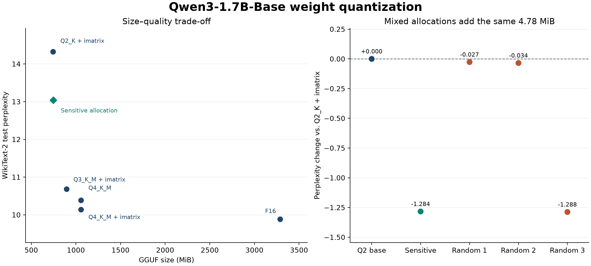

# Qwen3-1.7B 低位宽量化实测报告

2026-11-24 · RTX 5070 Ti Laptop GPU · `llama.cpp b12100` · Windows 11

**4 bit 校准方案缩小了约 68% 的模型文件，解码吞吐达到 F16 的 2.35 倍。** 在低位宽基线上，给 3 个张量升位宽只增加 4.78 MiB，测试集困惑度下降 8.96%。包含第 27 层的随机组取得了几乎相同的结果，说明在本次候选和预算下，选中这一层比其余两处的选择更重要。

## 整模型评测

所有模型从同一份 F16 GGUF 生成。测试采用 WikiText-2 的 584 个完整 512-token 块。Prefill 和 decode 分别取 `pp512` 和 `tg128` 的 5 次重复，表中为均值 ± 标准差。显存按 100 ms 采样，末列依次为设备峰值与较空闲新增值。

| 模型 | 文件大小（MiB） | 测试集 PPL ↓ | Prefill（tokens/s） | Decode（tokens/s） | 显存峰值 / 新增（MiB） |
|---|---:|---:|---:|---:|---:|
| F16 | 3287.65 | 9.8853 | 12501 ± 681 | 119.3 ± 7.1 | 4707 / 3918 |
| Q4_K_M | 1056.11 | 10.3899 | 13264 ± 698 | 275.0 ± 17.1 | 2378 / 1592 |
| Q4_K_M + imatrix | 1056.11 | 10.1426 | 13831 ± 1230 | 280.8 ± 16.9 | 2383 / 1585 |
| Q3_K_M + imatrix | 896.01 | 10.6851 | 12095 ± 682 | 254.7 ± 23.4 | 2214 / 1426 |
| Q2_K + imatrix | 741.76 | 14.3239 | 10378 ± 665 | 323.6 ± 15.1 | 2064 / 1278 |
| 敏感组 | 746.54 | 13.0404 | 10029 ± 237 | 322.6 ± 8.9 | 2072 / 1277 |
| 随机组 1 | 746.54 | 14.2973 | 10021 ± 306 | 322.1 ± 12.2 | 2064 / 1271 |
| 随机组 2 | 746.54 | 14.2894 | 10290 ± 984 | 324.9 ± 14.3 | 2074 / 1277 |
| 随机组 3 | 746.54 | 13.0362 | 10355 ± 644 | 322.0 ± 14.2 | 2064 / 1277 |

- **校准的影响。** `Q4_K_M` 加入 `imatrix` 后，PPL 从 10.3899 降至 10.1426，部署文件只增加了 224 字节。与 F16 相比，该版本 PPL 高 2.60%，文件体积小 67.88%，实际解码吞吐为 280.8 tokens/s。
- **最低位宽的取舍。** `Q2_K + imatrix` 压到 741.76 MiB，解码为 323.6 tokens/s，PPL 为 14.3239。它在本次测试中解码较快，prefill 则从 F16 的约 12,501 tokens/s 降至约 10,378 tokens/s。

## 同预算混合位宽

八个 `ffn_down.weight` 的基线类型均为 `Q3_K`。逐个提升到 `Q4_K` 并用验证集前 32 块排序。给第 27 层单独升位宽时，验证集 PPL 从 10.4896 降至 9.6204，改善明显大于其余候选。

| 方案 | 升位宽的层 | 文件新增 | 测试集 PPL |
|---|---|---:|---:|
| 敏感组 | 27、12、4 | 4.78125 MiB | 13.0404 |
| 随机组 1 | 0、4、8 | 4.78125 MiB | 14.2973 |
| 随机组 2 | 12、23、8 | 4.78125 MiB | 14.2894 |
| 随机组 3 | 15、23、27 | 4.78125 MiB | 13.0362 |

敏感组恢复了低位宽相对 F16 的 **25.31% 平均负对数似然差距**。其 PPL 比三个随机组的均值低 0.8339，但比同样选中第 27 层的随机组 3 高 0.0042。这次实验支持优先为第 27 层分配位宽。三组随机样本和一套英文语料所覆盖的范围有限。

## 手写 INT4 结果

用第 0 层的两块真实 Qwen3 权重，各自测试三个分组大小。负载含打包权重和每组一个 FP32 scale。分组由 32 增至 128 时，attention `q_proj` 的线性层相对 L2 输出误差增加 2.63 个百分点，MLP `down_proj` 增加 2.33 个百分点。

| 权重 | 分组 | INT4 负载（MiB） | 权重相对误差 | 输出相对误差 |
|---|---:|---:|---:|---:|
| `q_proj` | 32 / 64 / 128 | 2.50 / 2.25 / 2.13 | 10.15% / 11.47% / 12.77% | 10.15% / 11.47% / 12.78% |
| `down_proj` | 32 / 64 / 128 | 7.50 / 6.75 / 6.38 | 10.01% / 11.21% / 12.35% | 10.01% / 11.21% / 12.34% |

## 复现与验证

- [运行说明和实验设计](../README.md)
- [原始指标 CSV](metrics.csv) · [INT4 分组结果](int4_layer_errors.csv) · [敏感度排名](sensitivity.csv)
- [固定协议和数据散列](protocol.json) · [分配清单](allocations.json) · [字节预算审计](allocation_audit.csv)
- [逐项结果复核](logs/final_verification.log)。复跑时，原始运行日志和环境快照可保存在本地 `results` 目录。

Windows 版 `llama-imatrix` 读入整份训练文件时在分词阶段崩溃。本项目传入训练文件的 UTF-8 前缀，并验证程序仍恰好使用前 32 个校准块。验证和测试读取各自的原始文件。指标范围为当前 checkpoint、固定上下文和 WikiText-2，吞吐值对应本机指定微基准。
